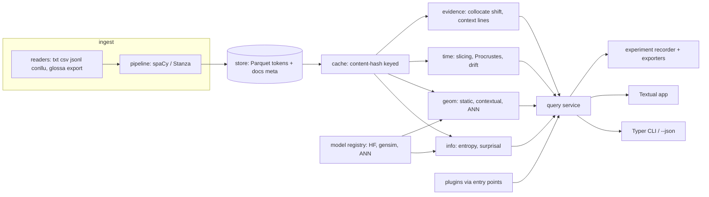
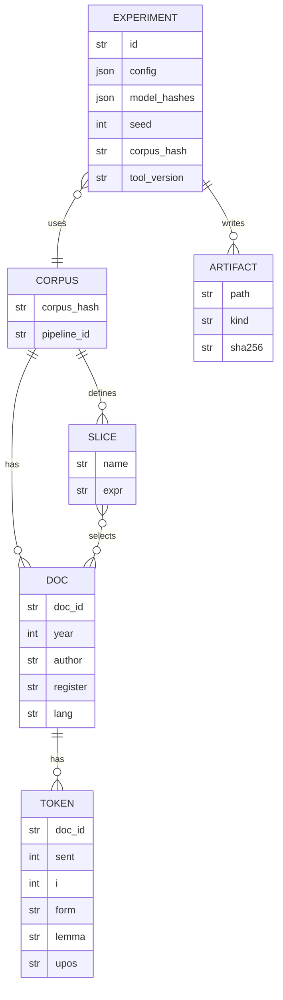

# langSuite — build plan / spec (v2)

Package and binary: `langsuite`. Owner: ao3575911. Licence: MIT. Docs: GitHub Pages (mkdocs-material). The name lives only in `src/langsuite/_meta.py`.

**Tagline:** *Semantic change you can defend: model-driven measurement of meaning, surprisal and change.*

## Decisions (Adam, 30 Oct 2026)

- Name: langSuite.
- Default LM: `distilgpt2` (Apache-2.0). A multilingual LM is opt-in, and its licence is checked at load time.
- spaCy is the default pipeline; Stanza is the optional extra `langsuite[stanza]`.
- No PyPI or npm registration yet. Adam signs the tags.

## Direction

langSuite is the **model-driven measurement lab** for language research: language-model surprisal, embedding geometry and semantic change, with statistics a reviewer can check and experiments that re-run byte for byte. It uses the Python ML stack (PyTorch, transformers, gensim) because that is where the models live. It does **not** try to be a general corpus workbench: [glossa](https://github.com/ao3575911/glossa) owns that.

## langSuite vs glossa

Both are Adam's projects. They are deliberately split so they don't overlap.

| | **glossa** | **langSuite** |
|---|---|---|
| One line | Every linguist's research tool, in one fast terminal workspace | Model-driven measurement of meaning, surprisal and change |
| Language / runtime | Rust, ratatui, single static binary | Python 3.12+, Textual, uv / pip, optional GPU |
| Core question | *Where and how often does X occur?* | *How predictable is X, what does it mean, and has that changed — with what confidence?* |
| Owns | Import of many formats (TXT/HTML/DOCX/PDF/TEI/CHAT/ELAN); positional index; KWIC + CQL; frequency, n-grams, collocations (MI, t, LL, logDice); keyness; dispersion; UD parsing and treebank query; phonetics, IGT, fieldwork, typology, norms-matched stimuli | LM surprisal / perplexity / entropy per token; static and contextual embeddings; neighbours, CSLS, semantic axes, sense clusters; aligned semantic change with intervals, permutation tests, FDR and null controls; cross-lens evidence cards; benchmark against SemEval-2020 Task 1; experiment replication (seeds, model hashes) |
| Not in scope | Training or running neural LMs/embeddings as a core feature | General concordancing, CQL, keyness reports, parsing, annotation, phonetics, multi-format import |
| Data in | Raw documents | Plain text / JSONL / CSV / CoNLL-U, **or a glossa corpus export** (CoNLL-U, NDJSON or Parquet) |
| Typical user moment | Building and querying a corpus | Testing a hypothesis about meaning or processing on that corpus |
| Scale strategy | Index, sub-second queries | Cache model outputs, batch on CPU/GPU, replicate runs |

**Interop, not overlap.**
- langSuite reads glossa exports directly (`langsuite ingest --from glossa`).
- langSuite JSON output uses a compatible provenance envelope (`version, command, params, corpus_hash, model_hashes`), so glossa's session log and methods generator can cite langSuite runs.
- glossa's planned module 6 (embeddings / sense clustering) could call langSuite through glossa's external-process plugin protocol instead of reimplementing it. **That is Adam's call (open decision 1).**
- The context lines inside a langSuite evidence card are a small internal view, not a concordancer; for real KWIC, use glossa.

## Novelty check

A scan on 30 Oct 2026 found plain "Procrustes drift + neighbours" already done:
- [semantic-drift](https://github.com/vmanam1/semantic-drift): terminal, per-era word2vec, Procrustes.
- WoVis (DialRes 2026), TextEssence (2021) and TASC: web tools.

Their gaps are where langSuite starts:
1. No uncertainty: seed noise reads as change (Hellrich & Hahn 2016).
2. Frequency and topic shifts masquerade as meaning change (Dubossarsky et al. 2017).
3. One vector per word.
4. No checkable evidence.

**Wedge — calibrated, controlled, corroborated change:**
- **Calibrated:** seed and bootstrap replicates give each change score a 95% interval and a permutation p-value with BH-FDR. Unstable words are flagged, not ranked.
- **Controlled:** frequency-matched controls and a shuffled-slice null. Change is reported net of the null.
- **Corroborated:** each flagged word gets an evidence card that combines
  - the shift in its in-context surprisal;
  - the shift in its NPMI collocates;
  - sampled context lines per slice;
  - sense-cluster proportions (contextual).
  A change is "supported" only when at least two lenses agree.
- **Benchmarked:** `langsuite bench semeval2020` scores against the gold data (Schlechtweg et al. 2020) when the user supplies it.
- **Replicable:** every run is an experiment record; `exp rerun` reproduces identical artefact hashes.

Verified versions (PyPI latest, 30 Oct 2026). Pins will be `>=` these minor versions:

| Package | Version | Use |
|---|---|---|
| textual | 8.2.8 | TUI |
| typer | 0.27.3 | CLI |
| spacy | 3.8.18 | tokenise / lemma / POS |
| stanza | 1.15.0 | alt. pipeline, wider language coverage |
| transformers | 5.22.0 | LM surprisal, hidden states |
| torch | 2.15.0 | backend (CPU wheel default) |
| sentence-transformers | 6.2.0 | sentence vectors |
| gensim | 4.4.0 | word2vec / fastText training, KeyedVectors |
| fasttext | 0.9.3 | optional; gensim covers training. Maintenance status UNKNOWN |
| faiss-cpu | 1.15.1 | ANN (optional extra) |
| hnswlib | 0.8.0 | ANN (default, small wheel) |
| plotext | 6.1.0 | terminal charts |
| textual-plotext | 1.0.1 | plotext widget for Textual |
| polars | 2.1.0 | tables |
| pyarrow | 26.0.0 | Parquet |
| numpy / scipy / scikit-learn | 2.5.4 / 1.18.1 / 1.9.1 | maths, Procrustes, clustering |
| networkx | 3.7 | neighbour graph |
| matplotlib | 3.11.2 | PNG/SVG export |
| xxhash | 4.0.2 | content hashing |
| platformdirs | 4.14.0 | cache paths |
| pydantic | 2.14.2 | config / experiment schema |
| pytest / hypothesis | 9.2.0 / 6.170.13 | tests |
| ruff / mypy / pyright | 0.17.3 / 2.4.1 / 1.1.414 | lint, types |
| mkdocs-material | 9.8.0 | docs site |

Python 3.12+ support in every package: assumed from current releases, not checked one by one. Treat it as UNKNOWN until M0 CI passes on 3.12 and 3.13. `uv` version: UNKNOWN (it's not a PyPI dependency; pin it in CI).


---

## 1. Vision and users

A researcher points langSuite at a sliced corpus (by era, register, author or language) and asks model-based questions: which words changed meaning, how surprising is this construction to a language model, where does this word sit on a good–bad axis in 1850 vs 1950. Each answer comes with an interval, a null comparison and the evidence behind it, plus a methods paragraph. It runs offline on a laptop CPU and scales to a GPU.

| User | Top jobs |
|---|---|
| **Maya, historical linguistics PhD student** | Find words that changed meaning between decades, with confidence intervals; show reviewers the evidence card; export a figure and methods paragraph |
| **Tomás, psycholinguist** | Per-token surprisal and entropy for stimulus sets from a pinned LM; compare conditions; a CSV for R with the model hash |
| **Priya, computational social scientist** | Compare framing across outlets on semantic axes (e.g. "migrant" on threat–welcome), with bootstrap CIs and replicate stability |

## 2. Competitive scan

| Tool | Strong at | Lacks (for this job) |
|---|---|---|
| glossa (Adam's) | Corpus workbench: index, KWIC/CQL, stats, parsing | Model-driven measures — by design; see above |
| AntConc / Sketch Engine / #LancsBox | Concordance, collocation, keyness | No LM surprisal, no calibrated semantic change |
| semantic-drift | Terminal Procrustes drift | No intervals, nulls or second lens; fixed corpus |
| WoVis / TextEssence / TASC | Interactive change visualisation | Web-only; no significance or null control; no surprisal |
| HistWords (Hamilton et al.) | Reference diachronic method | Research code with fixed corpora |
| minicons / lm-zoo | LM surprisal from HF models | Single lens; no corpus slicing, geometry or change |
| gensim / whatlies | Embedding training / visualisation | Libraries; no workflow, stats or provenance |

## 3. Features (MoSCoW)

**Must**
- Ingest txt/jsonl/csv/CoNLL-U and glossa exports. Metadata gives the slice keys. A content-hashed cache.
- Information measures with bootstrap CIs: H1, H2, conditional H, MATTR, Zipf/Heaps fits, KL/JS between slices. *(These are distributional baselines that glossa doesn't compute.)*
- Static embeddings (gensim word2vec/fastText) with seed replicates; hnswlib; neighbours, CSLS, analogy, semantic axes.
- Semantic change: Procrustes, intervals, permutation p, BH-FDR, frequency-matched and shuffled nulls.
- LM surprisal / perplexity / next-token entropy (`distilgpt2`), offline.
- Evidence cards; experiment records; `--json`; graceful failure.

**Should**
- Contextual embeddings (sentence-transformers / HF hidden states, layer selection); sense clusters and their per-slice proportions.
- `bench semeval2020`.
- Textual TUI dashboard.
- A methods paragraph and BibTeX per experiment.
- FAISS; GPU.
- Plugin entry points (`langsuite.metrics`, `langsuite.models`).

**Could**
- A multilingual LM (opt-in, licence-gated).
- Cross-lingual alignment (CSLS).
- A glossa plugin adapter.

**Won't**
- KWIC/CQL concordancer, keyness reports, parsing, annotation or broad document import. glossa owns these.

## 4. Architecture



**Modules** (`src/langsuite/`): `_meta`, `ingest/`, `pipeline/`, `store/`, `cache/`, `models/`, `metrics/info.py`, `geom/`, `change/`, `query/`, `experiment/`, `export/`, `cli/`, `tui/`, `plugins/`.

**Data model** (Parquet, polars):



**Cache.** Key = `xxh3_128(input bytes) + pipeline_id + params_hash`. Layout is `platformdirs.user_cache_dir/<NAME>/{corpus,lm,vec,ann}/<key>/`. Writes are atomic (temp file then rename). `cache ls|prune|verify` commands.

**Model loading.** It's lazy and registry-based. HF models load with `local_files_only=True` when `--offline` or `HF_HUB_OFFLINE=1` is set. The model hash is the HF commit sha, or the sha256 of the files for local paths. The device is `cpu` by default, with `--device cuda|mps`. Long texts run through a sliding window with a stride (overlap is configurable), so surprisal is conditioned on up to the full context window.

**Plugin API** (entry-point groups `langsuite.metrics`, `langsuite.models`, `langsuite.readers`):

```python
class Metric(Protocol):
    name: str
    citation: str  # BibTeX key

    def compute(self, ctx: SliceContext, **params: Any) -> pl.DataFrame: ...


class Reader(Protocol):
    suffixes: tuple[str, ...]

    def read(self, path: Path) -> Iterator[RawDoc]: ...


class VectorModel(Protocol):
    def vectors(self, terms: Sequence[str]) -> npt.NDArray[np.float32]: ...
    def fingerprint(self) -> str: ...
```

## 5. CLI and TUI

```
langsuite
├── init                                   workspace (langsuite.toml + .langsuite/)
├── ingest PATH... [--format txt|jsonl|csv|conllu] [--from glossa] [--meta K=V] [--pipeline auto|basic|spacy:MODEL|stanza:LANG]
├── slice define NAME EXPR | slice ls      EXPR is a filter on metadata, e.g. "year < 1900"
├── corpus info
├── info  entropy|mattr|zipf|heaps [--slice S] [--bootstrap 200]
├── info  divergence A B [--measure kl|js]
├── lm    surprisal [--text|--file|--slice] [--model distilgpt2] [--stride 256] [--device cpu]
├── lm    pull MODEL                       fetch once, for offline use
├── vec   train [--slice S] [--algo w2v|fasttext] [--seeds 5] [--dim 100]
├── vec   nn WORD [-k 20] [--csls] | vec analogy A B C | vec axis WORD... --pos .. --neg ..
├── change score --slices A,B [--top 50] [--bootstrap 200] [--permutations 1000]
├── change drift WORD --slices A,B,C
├── change evidence WORD --slices A,B      evidence card across lenses
├── sense WORD [--model ...] [--layer -1]
├── bench semeval2020 DIR
├── exp   ls | show ID | rerun ID | methods ID [--md|--latex]
├── cache ls | prune
└── tui
Global: --json  --debug  --workspace/-w  --offline  --seed
```

**TUI** (Textual). The screens are:
- **Changes:** the ranked table with intervals, q-values and a stability flag.
- **Word:** an evidence card with a drift chart (textual-plotext), neighbours per slice, surprisal shift, collocate shift and context lines.
- **Surprisal reader:** the text shaded by surprisal.
- **Geometry:** axes and neighbour graph.
- **Experiments:** the list, with re-run and export.

Selecting a word anywhere opens it in Word. Keys:

| Key | Action |
|---|---|
| `ctrl+p` | command palette |
| `/` | focus a word |
| `1`–`5` | screens |
| `h` | heatmap toggle |
| `s` | slices |
| `b` | back |
| `y` | copy the equivalent CLI command |
| `e` | export |
| `t` | theme |
| `?` | help |
| `q` | quit |

## 6. Metrics

Notation: f(w) is the count of w; N is the token count; p(w) = f(w)/N; V is the vocabulary.

| Metric | Definition | Reference |
|---|---|---|
| Shannon entropy | H(X) = −Σ p(x) log₂ p(x) (unigrams; bigrams over pairs) | Shannon 1948, *Bell Syst. Tech. J.* 27 |
| Conditional entropy | H(Y\|X) = H(X,Y) − H(X) | Shannon 1948; Cover & Thomas 2006 |
| TTR | \|V\| / N | Templin 1957 |
| MATTR | mean TTR over all windows of size W (default 500) | Covington & McFadden 2010, *J. Quant. Linguist.* 17(2) |
| Zipf fit | f(r) ∝ r^−α; MLE fit (not log-log OLS) | Zipf 1949; Clauset, Shalizi & Newman 2009, *SIAM Rev.* 51 |
| Heaps fit | \|V\|(N) = K·N^β; nonlinear least squares | Heaps 1978; Herdan 1960 |
| KL divergence | D(P‖Q) = Σ P log(P/Q), with add-λ smoothing on the shared vocabulary | Kullback & Leibler 1951 |
| JS divergence | ½D(P‖M)+½D(Q‖M), M=½(P+Q) | Lin 1991, *IEEE Trans. Inf. Theory* 37 |
| Surprisal | s(wᵢ) = −log₂ P(wᵢ \| w₍<i₎); a word's surprisal is the sum over its subword tokens | Hale 2001; Levy 2008, *Cognition* 106 |
| Perplexity | 2^(mean surprisal per token) | Jelinek et al. 1977 |
| PMI | log₂ [p(x,y) / (p(x)p(y))] | Church & Hanks 1990, *Comput. Linguist.* 16(1) |
| NPMI | PMI / −log₂ p(x,y), in [−1, 1] | Bouma 2009, GSCL |
| Cosine | u·v / (‖u‖‖v‖) | — |
| CSLS | 2cos(x,y) − r_T(x) − r_S(y), with r the mean cosine to the k=10 nearest neighbours | Conneau et al. 2018, ICLR ("Word Translation Without Parallel Data") |
| Analogy | argmax cos(d, b − a + c) (3CosAdd); 3CosMul as an option | Mikolov et al. 2013; Levy & Goldberg 2014 |
| Semantic axis | proj(w) = cos(w, mean(pos) − mean(neg)) | Bolukbasi et al. 2016; An et al. 2018 (SemAxis) |
| Procrustes alignment | R = argmin ‖WR − W′‖_F s.t. RᵀR = I; R = UVᵀ from the SVD of WᵀW′ | Schönemann 1966; Hamilton, Leskovec & Jurafsky 2016, ACL |
| Change score | 1 − cos(w_t, R·w_{t+1}); plus neighbour-overlap (Jaccard of the k-NN) as a second measure | Hamilton et al. 2016; Gonen et al. 2020, ACL |
| Sense clusters | k-means on contextual vectors, k chosen by silhouette | Giulianelli et al. 2020, ACL |

| Bootstrap interval | percentile CI over B document-level resamples (default B=200) | Efron & Tibshirani 1993 |
| Permutation p, BH-FDR | p from slice-label permutations; q via Benjamini–Hochberg | Benjamini & Hochberg 1995, *JRSS B* 57 |
| Shuffled-slice null | the change score after random reassignment of documents to slices | Dubossarsky, Weinshall & Grossman 2017, EMNLP |
| Seed stability | Jaccard of top-k neighbours across seed replicates | Hellrich & Hahn 2016, COLING; Antoniak & Mimno 2018, TACL |

Every metric's BibTeX goes in `refs.bib`. The methods paragraph lists only the measures that were actually run.

## 7. Milestones

Each milestone is one PR, merged only with CI green on 3.12 and 3.13.

| M | Scope | Acceptance |
|---|---|---|
| M0 | Skeleton, error model, CI, docs workflow | ✅ merged (#1) |
| M1 | Workspace, ingest (txt/jsonl/csv/CoNLL-U), basic + spaCy pipelines, slices, cache | Golden token counts on fixtures; a re-ingest is a cache hit; bad input gives exit 3 with a hint; hypothesis: hashing is stable and order-independent of metadata |
| M2 | Information measures with bootstrap CIs, KL/JS | Golden values to 1e-9 on fixtures; JS is symmetric and in [0,1]; MATTR equals TTR when W=N (hypothesis) |
| M3 | Static embeddings with seed replicates, hnswlib, nn/CSLS/analogy/axis | Same seed gives the same vectors; stability Jaccard is reported; a missing word is exit 3 with near-miss suggestions |
| M4 | Semantic change: Procrustes, bootstrap CI, permutation p, BH-FDR, frequency-matched + shuffled nulls | Synthetic: rotation recovered (err <1e-6); injected words reach q<0.05; under a shuffled null, at most 5% of runs flag anything |
| M5 | LM surprisal (distilgpt2), `lm pull`, offline mode, OOM handling | Matches a reference HF loop to 1e-4; `--offline` with no cache gives exit 4 plus the `lm pull` hint |
| M6 | Evidence cards + experiment records + methods paragraph | `exp rerun` gives identical artefact hashes; the card shows ≥2 lenses |
| M7 | Textual TUI | Pilot tests for every screen at 80×24 and 160×48 |
| M8 | Contextual embeddings + senses, `bench semeval2020`, glossa import, plugins, docs, demo GIF, release prep | SemEval loader tests on a synthetic layout; a plugin loads; docs build strict |

## 8. Risks

| Risk | Mitigation |
|---|---|
| Model size (torch alone is huge) | The core install has no torch. Extras: `[lm]`, `[ctx]`, `[faiss]`, `[stanza]`. Default model is `distilgpt2` (82M, Apache-2.0); CPU wheels |
| Model licences | Ship no weights. The registry records each model's licence and warns about non-commercial ones. Multilingual default model licence: UNKNOWN, check before choosing |
| Corpus licences | Test corpora are public domain or open licence only: Gutenberg, UD EWT (CC BY-SA 4.0), plus small slices of COHA-like corpora only if the licence allows (COHA itself is licensed, so it's not bundled) |
| Performance on big corpora | Streaming ingest, polars lazy scans, a batched LM with sliding windows, ANN over brute force, a progress bar, the cache |
| Small slices give noisy vectors | Minimum-frequency threshold; a bootstrap CI on the change score; a warning when a slice has fewer than ~1M tokens (threshold UNKNOWN, tune in M6) |
| Tokeniser mismatch (subword vs word) | Defined aggregation (sum over subwords) and recorded alignment; unit tests |
| Dependency churn (transformers 5.x, textual 8.x) | Upper-bound major versions; nightly CI against the latest versions |
| fasttext package maintenance | Train through gensim's FastText; the `fasttext` package is optional |

| Overlap with glossa | The split is in the table above; new features are checked against glossa's PRD before being added |

## 9. 60-second demo

```
langsuite init demo && cd demo
langsuite ingest corpus/*.jsonl --meta year=field:year      # pre-cached
langsuite slice define early "year < 1900"; langsuite slice define late "year >= 1900"
langsuite change score --slices early,late --top 5           # score, 95% CI, q, stable?
langsuite change evidence broadcast --slices early,late      # 3 lenses agree -> supported
langsuite tui                                                 # Changes -> Word card
langsuite exp methods last --md
```

Record it with asciinema and render it with `agg`: high resolution, cropped clean, a smooth loop under 60 s. Whether a public-domain corpus shows a strong enough effect: UNKNOWN; check in M4 (fall back to a documented synthetic corpus).

## Open decisions (Adam)

1. Should glossa's module 6 (embeddings / senses) delegate to langSuite through glossa's plugin protocol, or stay separate?
2. Tag signing for releases (Adam).
3. PyPI registration and trusted publisher, when ready.

## Failure handling (all commands)

- Errors follow one format: `error: <what>` + `hint: <fix>`, with exit codes 2 (usage), 3 (input), 4 (model/offline), 5 (resources). There are no tracebacks unless `--debug` is set.
- Missing optional extras give a hint naming the extra to install (`pip install "langsuite[lm]"`).
- When offline, the error names the model and says how to fetch it ahead of time.
- Out of memory (MemoryError or CUDA OOM) prints a hint to lower `--batch` or use `--device cpu`.
