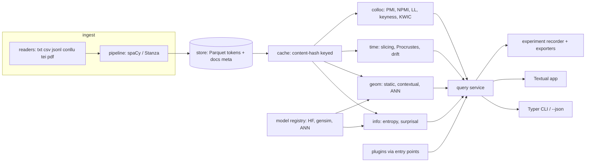
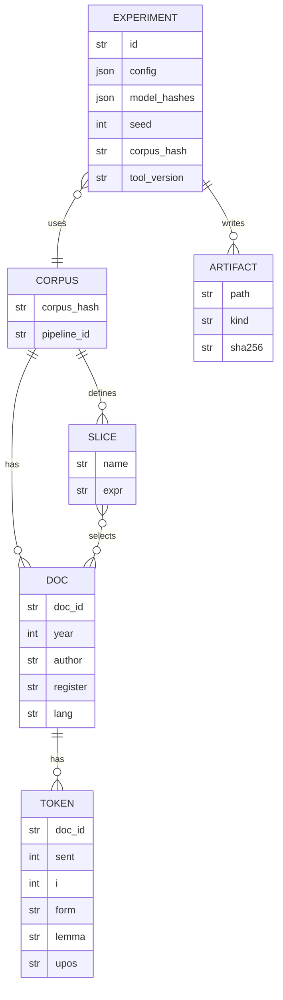
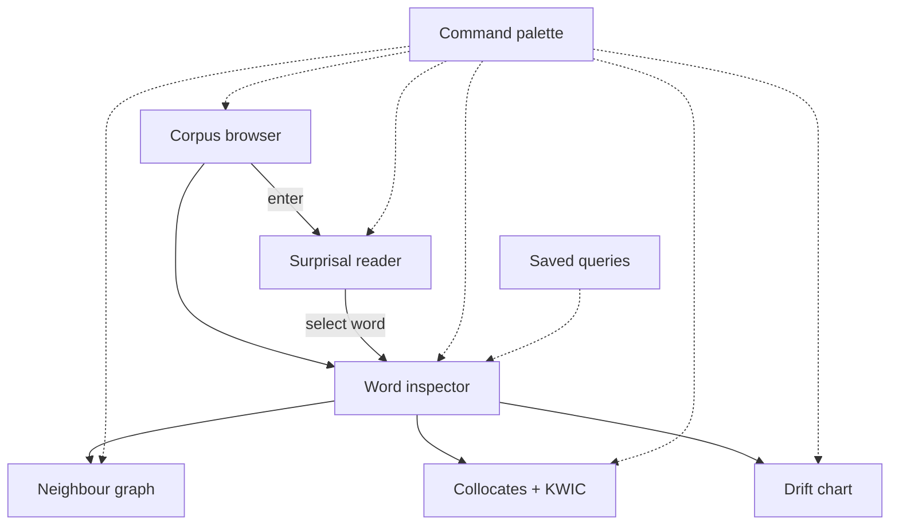

# langSuite — build plan / spec

Package and binary: `langsuite`. Owner: ao3575911. Licence: MIT. Docs: GitHub Pages (mkdocs-material).
The code is name-neutral: the name lives only in `src/langsuite/_meta.py`.

## Decisions (Adam, 30 Oct 2026)

- Name: **langSuite**. Tagline: *"Semantic change you can defend: information, geometry and time in one terminal."*
- Default LM: `distilgpt2` (Apache-2.0). A multilingual LM is opt-in, and its licence is checked at load time.
- Pipeline: spaCy by default; Stanza is an optional extra, `langsuite[stanza]`.
- No PyPI or npm registration yet. Adam signs the tags.

## Novelty check and pivot

A scan on 30 Oct 2026 found the plain "Procrustes drift + neighbours" idea already done:
- [semantic-drift](https://github.com/vmanam1/semantic-drift): terminal lookup, per-era word2vec, Procrustes alignment.
- WoVis (DialRes 2026), TextEssence (NAACL 2021) and TASC: web tools for the same job.

Shipping only that would not impress. Known weak points of those tools:
1. Drift scores carry no uncertainty, so random seed noise looks like change (Hellrich & Hahn 2016).
2. Frequency and topic shifts masquerade as meaning change (Dubossarsky et al. 2017, "Outta Control").
3. One vector per word, so polysemy is averaged away.
4. No link to evidence a reviewer can check.

**Upgraded wedge: evidence-grade change detection.**
- *Calibrated:* replicate models over seeds and bootstrap resamples. Each word gets a change score, a 95% interval and a permutation p-value with Benjamini–Hochberg FDR. Words below the stability floor are flagged, not ranked.
- *Controlled:* frequency-matched control words and a shuffled-slice null (Dubossarsky et al. 2017). Results are reported as change minus null.
- *Corroborated:* every flagged word gets an evidence card from the other two lenses:
  - the surprisal shift of the word in context per slice;
  - the collocate shift (NPMI top-k Jaccard);
  - KWIC lines sampled per slice.
  A change is "supported" only when at least two lenses agree.
- *Benchmarked:* `langsuite bench semeval2020` scores against SemEval-2020 Task 1 (Schlechtweg et al. 2020) when the user supplies the data. That corpus is licence-gated, so it is not bundled.
- The evidence card exports straight into the methods paragraph.

The rest of the original plan stays; milestone M6 is widened to cover this (see §7).

Verified versions (PyPI latest, 30 Oct 2026). Pins will be `>=` these minor versions:

| Package | Version | Use |
|---|---|---|
| textual | 8.2.8 | TUI |
| typer | 0.27.3 | CLI |
| spacy | 3.8.18 | tokenise / lemma / POS |
| stanza | 1.15.0 | alt. pipeline, wider language coverage |
| transformers | 5.22.0 | LM surprisal, hidden states |
| torch | 2.15.0 | backend (CPU wheel default) |
| sentence-transformers | 6.2.0 | sentence vectors |
| gensim | 4.4.0 | word2vec / fastText training, KeyedVectors |
| fasttext | 0.9.3 | optional; gensim covers training. Maintenance status UNKNOWN |
| faiss-cpu | 1.15.1 | ANN (optional extra) |
| hnswlib | 0.8.0 | ANN (default, small wheel) |
| plotext | 6.1.0 | terminal charts |
| textual-plotext | 1.0.1 | plotext widget for Textual |
| polars | 2.1.0 | tables |
| pyarrow | 26.0.0 | Parquet |
| numpy / scipy / scikit-learn | 2.5.4 / 1.18.1 / 1.9.1 | maths, Procrustes, clustering |
| networkx | 3.7 | neighbour graph |
| conllu | 6.0.0 | CoNLL-U reader |
| lxml | 6.1.3 | TEI reader |
| pypdf | 6.21.4 | PDF text extraction |
| matplotlib | 3.11.2 | PNG/SVG export |
| xxhash | 4.0.2 | content hashing |
| platformdirs | 4.14.0 | cache paths |
| pydantic | 2.14.2 | config / experiment schema |
| pytest / hypothesis | 9.2.0 / 6.170.13 | tests |
| ruff / mypy / pyright | 0.17.3 / 2.4.1 / 1.1.414 | lint, types |
| mkdocs-material | 9.8.0 | docs site |

Python 3.12+ support in every package: assumed from current releases, not checked one by one. Treat it as UNKNOWN until M0 CI passes on 3.12 and 3.13. `uv` version: UNKNOWN (it's not a PyPI dependency; pin it in CI).

---

## 1. Vision and users

One terminal workspace where a researcher loads a corpus once and sees three linked views of any word: how predictable it is (information), what it sits near (geometry), and how both shift across eras, registers, authors or languages (change). Every result is reproducible, citable and scriptable. It's CPU-first, works offline, and ships no lock-in.

| User | Top jobs |
|---|---|
| **Maya, historical linguistics PhD student** | Slice a 1800–2000 corpus by decade; find words whose meaning moved; show the neighbour drift; export a figure plus a methods paragraph for the thesis. |
| **Tomás, psycholinguist** | Get per-token surprisal for stimulus sentences from a fixed LM; compare conditions; produce a CSV for R with model hash and seed. |
| **Priya, corpus/discourse analyst** | Compare two subcorpora (e.g. left/right press): keyness, collocates, KWIC, JS divergence; dig into a keyword's neighbours and contexts. |

## 2. Competitive scan

| Tool | Strong at | Lacks |
|---|---|---|
| AntConc (4.x) | KWIC, collocates, keyness; free | No embeddings, no surprisal, no time alignment; GUI only, not scriptable |
| Sketch Engine | Huge corpora, word sketches, diachronic tools | Paid, hosted, closed; corpora on their servers; limited LM surprisal; methods not fully reproducible locally |
| Voyant Tools | Quick browser visualisation | Shallow statistics, no embeddings or change model, weak on large corpora |
| #LancsBox (X) | Collocation graphs (GraphColl), good stats | No contextual embeddings or surprisal; desktop GUI; licence not OSI |
| gensim | Training static embeddings | Library only: no UI, no corpus stats, no alignment workflow |
| whatlies | Embedding visualisation | Notebook-centric; maintenance status UNKNOWN |
| HistWords (Hamilton et al.) | Reference diachronic method | Research code with fixed corpora, not a tool |
| semantic-drift (vmanam1) | Terminal drift lookup, Procrustes | No uncertainty or nulls, single lens, fixed corpus |
| WoVis / TextEssence / TASC | Interactive change visualisation | Web tools; no significance testing; no surprisal; no reproducible record |
| lm-surprisal style scripts (e.g. `minicons`) | Surprisal from HF models | Single lens; no corpus or geometry views |

**Our wedge (after pivot, see top):** calibrated, controlled, corroborated change. Also: the only tool that (a) cross-links surprisal, neighbours, collocates, KWIC and drift for one word, live; (b) runs locally and offline in a terminal; (c) writes a reproducible experiment record plus a cited methods paragraph. It's built for researchers who script, but useful to those who don't.

## 3. Features (MoSCoW)

**Must** (the thesis fails without these)
- Ingest txt/csv/jsonl/CoNLL-U/TEI/PDF-text; metadata columns (year, author, register, lang) as slice keys. *Slicing is what makes the third lens work.*
- spaCy pipeline by default, Stanza as an option; streaming; content-hashed cache. *Big corpora need to be cheap to re-run.*
- Entropy suite: H1, H2, conditional H, TTR, MATTR, Zipf and Heaps fits, KL/JS between slices.
- Surprisal from a local HF causal LM (default `distilgpt2`, Apache-2.0), a heatmap reader.
- Static embeddings: train word2vec/fastText on the corpus, or load GloVe/fastText vectors. hnswlib index.
- k-NN (cosine), CSLS, analogy, semantic axes.
- Semantic change: per-slice training, Procrustes alignment, change score, neighbour drift timeline.
- PMI, NPMI, log-likelihood collocates; keyness vs a reference corpus; KWIC.
- Cross-linked word inspector in the TUI.
- Experiment records plus CSV/Parquet/JSON export; a CLI equivalent for every action; `--json`.

**Should** (high value, not blocking)
- Contextual embeddings (sentence-transformers, HF hidden states with layer selection).
- Sense clusters from contextual vectors (k-means/agglomerative + silhouette).
- 2-hop neighbour graph view.
- Markdown/LaTeX methods paragraph with BibTeX.
- FAISS backend; GPU switch.
- Plugin entry points for metrics and models.

**Could**
- Multilingual LM default (e.g. `mGPT` / `bloom-560m`; licence must be checked, so UNKNOWN for now).
- Cross-lingual alignment (MUSE-style CSLS).
- Saved query sets, themes, asciinema recorder hook.

**Won't (v1)**
- Hosted service, corpus hosting, annotation editing, model fine-tuning beyond static embeddings.

## 4. Architecture



**Modules** (`src/langsuite/`): `_meta`, `ingest/`, `pipeline/`, `store/`, `cache/`, `models/`, `metrics/info.py`, `metrics/colloc.py`, `geom/`, `change/`, `query/`, `experiment/`, `export/`, `cli/`, `tui/`, `plugins/`.

**Data model** (Parquet, polars):



**Cache.** Key = `xxh3_128(input bytes) + pipeline_id + params_hash`. Layout is `platformdirs.user_cache_dir/<NAME>/{corpus,lm,vec,ann}/<key>/`. Writes are atomic (temp file then rename). `cache ls|prune|verify` commands.

**Model loading.** It's lazy and registry-based. HF models load with `local_files_only=True` when `--offline` or `HF_HUB_OFFLINE=1` is set. The model hash is the HF commit sha, or the sha256 of the files for local paths. The device is `cpu` by default, with `--device cuda|mps`. Long texts run through a sliding window with a stride (overlap is configurable), so surprisal is conditioned on up to the full context window.

**Plugin API** (entry-point groups `langsuite.metrics`, `langsuite.models`, `langsuite.readers`):

```python
class Metric(Protocol):
    name: str
    citation: str            # BibTeX key
    def compute(self, ctx: SliceContext, **params: Any) -> pl.DataFrame: ...

class Reader(Protocol):
    suffixes: tuple[str, ...]
    def read(self, path: Path) -> Iterator[RawDoc]: ...

class VectorModel(Protocol):
    def vectors(self, terms: Sequence[str]) -> npt.NDArray[np.float32]: ...
    def fingerprint(self) -> str: ...
```

## 5. CLI and TUI

```
langsuite
├── init                         new workspace (workspace.toml)
├── ingest PATH... [--format] [--pipeline spacy:en_core_web_sm|stanza:en] [--meta col=...]
├── slice define NAME EXPR       e.g. "year>=1900 and year<1950"
├── slice ls
├── info  entropy|ttr|mattr|zipf|heaps [--slice] [--window 500]
├── info  divergence A B [--kl|--js]
├── info  surprisal [--model distilgpt2] [--doc|--text] [--stride]
├── vec   train [--algo w2v|fasttext] [--slice] [--seed]
├── vec   load PATH  |  vec contextual [--model] [--layer]
├── vec   index [--backend hnswlib|faiss]
├── nn    WORD [-k 20] [--csls] [--hops 2]
├── nn    analogy A B C   |  nn axis WORD... --pos good --neg bad
├── sense WORD [--k auto]
├── change evidence WORD        evidence card across lenses
├── bench semeval2020 DIR
├── change align --slices s1,s2,... | change score [--top 50] | change drift WORD
├── colloc WORD [--measure pmi|npmi|ll] [--span 5] [--min-freq 5]
├── keyness --target A --ref B [--measure ll]
├── kwic  WORD [--width 40] [--slice]
├── exp   ls | show ID | rerun ID | methods ID [--md|--latex]
├── export ID --to csv|parquet|json|png|svg
├── cache ls|prune|verify
├── batch FILE.toml              headless pipeline
└── tui
Global: --json  --offline  --device  --seed  --workspace  -q/-v
```

**TUI screen map**



The layout is a 3-column grid: browser | main | inspector. Below about 100 columns it collapses to tabs. When the focus word changes, a `WordSelected` message goes to every panel, and each panel refreshes from the query service in a worker, so the UI never blocks.

| Key | Action |
|---|---|
| `ctrl+p` | command palette |
| `/` | find word, set focus |
| `1`–`6` | browser, reader, inspector, graph, collocates/KWIC, drift |
| `n` / `N` | next / previous KWIC hit |
| `h` | toggle surprisal heatmap |
| `s` | choose slice |
| `enter` | focus word under cursor |
| `b` | back in focus history |
| `ctrl+s` | save query |
| `e` | export current panel |
| `t` | cycle theme |
| `?` | help |
| `q` | quit |

## 6. Metrics

Notation: f(w) is the count of w; N is the token count; p(w) = f(w)/N; V is the vocabulary.

| Metric | Definition | Reference |
|---|---|---|
| Shannon entropy | H(X) = −Σ p(x) log₂ p(x) (unigrams; bigrams over pairs) | Shannon 1948, *Bell Syst. Tech. J.* 27 |
| Conditional entropy | H(Y\|X) = H(X,Y) − H(X) | Shannon 1948; Cover & Thomas 2006 |
| TTR | \|V\| / N | Templin 1957 |
| MATTR | mean TTR over all windows of size W (default 500) | Covington & McFadden 2010, *J. Quant. Linguist.* 17(2) |
| Zipf fit | f(r) ∝ r^−α; MLE fit (not log-log OLS) | Zipf 1949; Clauset, Shalizi & Newman 2009, *SIAM Rev.* 51 |
| Heaps fit | \|V\|(N) = K·N^β; nonlinear least squares | Heaps 1978; Herdan 1960 |
| KL divergence | D(P‖Q) = Σ P log(P/Q), with add-λ smoothing on the shared vocabulary | Kullback & Leibler 1951 |
| JS divergence | ½D(P‖M)+½D(Q‖M), M=½(P+Q) | Lin 1991, *IEEE Trans. Inf. Theory* 37 |
| Surprisal | s(wᵢ) = −log₂ P(wᵢ \| w₍<i₎); a word's surprisal is the sum over its subword tokens | Hale 2001; Levy 2008, *Cognition* 106 |
| Perplexity | 2^(mean surprisal per token) | Jelinek et al. 1977 |
| PMI | log₂ [p(x,y) / (p(x)p(y))] | Church & Hanks 1990, *Comput. Linguist.* 16(1) |
| NPMI | PMI / −log₂ p(x,y), in [−1, 1] | Bouma 2009, GSCL |
| Log-likelihood G² | 2 Σ O log(O/E) over the 2×2 table | Dunning 1993, *Comput. Linguist.* 19(1); Rayson & Garside 2000 (keyness) |
| Cosine | u·v / (‖u‖‖v‖) | — |
| CSLS | 2cos(x,y) − r_T(x) − r_S(y), with r the mean cosine to the k=10 nearest neighbours | Conneau et al. 2018, ICLR ("Word Translation Without Parallel Data") |
| Analogy | argmax cos(d, b − a + c) (3CosAdd); 3CosMul as an option | Mikolov et al. 2013; Levy & Goldberg 2014 |
| Semantic axis | proj(w) = cos(w, mean(pos) − mean(neg)) | Bolukbasi et al. 2016; An et al. 2018 (SemAxis) |
| Procrustes alignment | R = argmin ‖WR − W′‖_F s.t. RᵀR = I; R = UVᵀ from the SVD of WᵀW′ | Schönemann 1966; Hamilton, Leskovec & Jurafsky 2016, ACL |
| Change score | 1 − cos(w_t, R·w_{t+1}); plus neighbour-overlap (Jaccard of the k-NN) as a second measure | Hamilton et al. 2016; Gonen et al. 2020, ACL |
| Sense clusters | k-means on contextual vectors, k chosen by silhouette | Giulianelli et al. 2020, ACL |

Every metric's BibTeX goes in `refs.bib`. The methods paragraph lists only the measures that were actually run.

## 7. Milestones

Each milestone is one PR (or a small set of PRs) and passes CI on 3.12 and 3.13 before the next starts.

| M | Scope | Acceptance test |
|---|---|---|
| M0 | Skeleton: uv, pyproject, ruff, mypy+pyright strict, pytest+hypothesis, CI, `_meta`, `--version` | CI green; `uv run langsuite --version` prints the version; strict type checks pass with zero errors |
| M1 | Ingest + store + cache (txt, jsonl, csv, CoNLL-U, TEI, PDF) with spaCy | Golden: the UD English EWT sample ingests to the expected token count; ingesting twice is a cache hit (<10% of the first run's time); a hypothesis test shows hashing is stable |
| M2 | Entropy suite + slices + KL/JS | Golden values on Gutenberg *Alice* (public domain) to 1e-6; JS is symmetric and lies in [0,1] (hypothesis); MATTR equals TTR when W=N |
| M3 | Collocates, keyness, KWIC | PMI/LL match hand-computed 2×2 tables; KWIC hit count equals the frequency |
| M4 | Static vectors + hnswlib + nn/analogy/axis/CSLS | Fixed seed gives the same top-10; on GloVe-50d the analogy king:man::queen:woman is in the top 5 (needs a download, so it's an opt-in test) |
| M5 | Surprisal (distilgpt2) + perplexity + offline mode | Per-token values match a reference script to 1e-4; `--offline` with no network passes after warm-up |
| M6 | Semantic change: slices, Procrustes, seed/bootstrap replicates, interval + permutation p + BH-FDR, frequency-matched and shuffled nulls, evidence cards (surprisal/collocate/KWIC), `bench semeval2020` | Synthetic: rotation recovered (err <1e-6); injected words rank top 5 with q<0.05; shuffled-slice null gives no word q<0.05 (hypothesis, 20 seeds) |
| M7 | TUI: all panels, cross-linking, keybindings | Textual `Pilot` snapshot tests; selecting a word refreshes all 5 panels; renders at 80×24 and 200×50 |
| M8 | Contextual vectors + senses, experiments, methods export, plugins, docs, PyPI release, GIF | `exp rerun` reproduces identical artefact hashes; an example plugin loads through its entry point; the docs build; TestPyPI install works on a clean venv |

## 8. Risks

| Risk | Mitigation |
|---|---|
| Model size (torch alone is huge) | The core install has no torch. Extras: `[lm]`, `[ctx]`, `[faiss]`, `[stanza]`. Default model is `distilgpt2` (82M, Apache-2.0); CPU wheels |
| Model licences | Ship no weights. The registry records each model's licence and warns about non-commercial ones. Multilingual default model licence: UNKNOWN, check before choosing |
| Corpus licences | Test corpora are public domain or open licence only: Gutenberg, UD EWT (CC BY-SA 4.0), plus small slices of COHA-like corpora only if the licence allows (COHA itself is licensed, so it's not bundled) |
| Performance on big corpora | Streaming ingest, polars lazy scans, a batched LM with sliding windows, ANN over brute force, a progress bar, the cache |
| Small slices give noisy vectors | Minimum-frequency threshold; a bootstrap CI on the change score; a warning when a slice has fewer than ~1M tokens (threshold UNKNOWN, tune in M6) |
| Tokeniser mismatch (subword vs word) | Defined aggregation (sum over subwords) and recorded alignment; unit tests |
| Dependency churn (transformers 5.x, textual 8.x) | Upper-bound major versions; nightly CI against the latest versions |
| fasttext package maintenance | Train through gensim's FastText; the `fasttext` package is optional |

## 9. 60-second demo

```
$ uvx langsuite init demo && cd demo                         # 3s
$ langsuite ingest gutenberg-1850-1950/*.txt --meta year=from:filename
$ langsuite slice define early "year<1900"; langsuite slice define late "year>=1900"
$ langsuite change align --slices early,late && langsuite change score --top 5
  gay  0.61   broadcast  0.48   awful  0.44 ...         # the punchline
$ langsuite tui                                              # focus "gay"
  → drift chart bends, neighbours move from "cheerful, merry" toward new
    senses; KWIC shows both eras; press h: surprisal heatmap in the reader
$ langsuite exp methods last --md                            # cited paragraph
```

Record it with asciinema, convert it to a GIF with `agg`, and keep it under 60 s. The data is pre-cached so it runs offline. Whether the 1850–1950 Gutenberg sample shows these drifts strongly enough: UNKNOWN, check in M6 (Hamilton et al. use COHA; *gay* and *broadcast* are their examples).

## Open decisions (Adam)

1. Tag signing for v0.x releases (Adam runs these).
2. Pages: the workflow deploys the docs; Pages source must be set to "GitHub Actions" if the API can't do it.
3. PyPI name registration and trusted publisher, when ready.

## Failure handling (all commands)

- Errors follow one format: `error: <what>` + `hint: <fix>`, with exit codes 2 (usage), 3 (input), 4 (model/offline), 5 (resources). There are no tracebacks unless `--debug` is set.
- Missing optional extras give a hint naming the extra to install (`pip install "langsuite[lm]"`).
- When offline, the error names the model and says how to fetch it ahead of time.
- Out of memory (MemoryError or CUDA OOM) prints a hint to lower `--batch` or use `--device cpu`.
